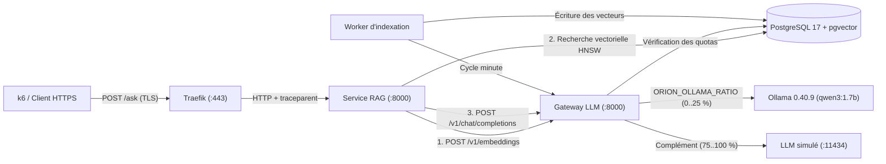

# Architecture d'Orion

**Orion** est l'assistant documentaire interne (RAG — *Retrieval-Augmented Generation*) de la DSI de l'entreprise fictive *Nordel*. Il permet à trois équipes internes — **Support** (`support`), **Ressources humaines** (`rh`) et **Développement** (`dev`) — d'interroger les procédures, runbooks et politiques internes en français.

---

## 1. Vue d'ensemble et parcours d'une requête

### Les étapes de traitement d'une question (`POST /ask`)

1. **Entrée TLS et traçage (`traefik`)** :
   - Traefik termine la connexion TLS sur le port `443` (publié sur `127.0.0.1:8443`), injecte ou propage l'en-tête W3C `traceparent` et route la requête vers le service `rag` (identifié par `service="rag@file"` dans les métriques de Traefik).
2. **Authentification et pipeline RAG (`rag`)** :
   - Le service `rag` authentifie l'équipe appelante à partir de l'en-tête `Authorization: Bearer sk-nordel-<équipe>-<aléa>`.
   - Son traitement se décompose en quatre étapes mesurées par l'histogramme `rag_stage_duration_seconds{stage="..."}` :
     - **`embed`** : appel à la gateway pour convertir la question en un vecteur de dimension `768` (`nomic-embed-text:v1.5`) ;
     - **`retrieval`** : recherche des passages les plus proches par distance cosinus (`<=>`) dans PostgreSQL (`pgvector`, index HNSW) ;
     - **`prompt`** : assemblage du prompt système et des passages documentaires retenus ;
     - **`generate`** : appel à la gateway pour produire la réponse finale à partir du contexte.
3. **Gateway LLM (`gateway`)** :
   - **Cache d'embeddings** : la gateway conserve en mémoire les vecteurs pré-calculés du jeu de questions de `k6` et des questions de référence (`gateway_embed_cache_requests_total{result="hit"|"miss"}`).
   - **Quotas par équipe** : avant chaque génération, la gateway vérifie dans PostgreSQL le budget de tokens de l'équipe (`support`, `rh`, `dev`). En cas de dépassement, elle renvoie `HTTP 429` et incrémente `gateway_quota_rejections_total{team="..."}`.
   - **Routage hybride** : la gateway répartit les requêtes de génération entre le véritable serveur **Ollama** (proportion fixée par `ORION_OLLAMA_RATIO`, entre `0` et `0,25`) et le **LLM simulé** (`llm-sim`), qui reproduit un profil de latence et des réponses extractives déterministes sans saturer le processeur ou le GPU.
   - **Bail de suspension pour la RCA (`:8090`)** : lorsque l'outil d'analyse de cause racine (`make rca`, lab 4b) interroge directement Ollama, il ouvre un bail temporaire (`ttl_seconds <= 60`) sur l'API interne `http://gateway:8090/internal/routing-pause`. Tant que ce bail est actif, la gateway route 100 % du trafic applicatif vers `llm-sim` et expose `gateway_real_routing_paused = 1`. Un bail non renouvelé expire automatiquement au bout de 60 s.
4. **Indexation périodique (`worker`)** :
   - Chaque minute, le `worker` vérifie les documents à indexer, calcule leurs embeddings via la gateway et met à jour PostgreSQL (`worker_last_success_timestamp_seconds`, `worker_documents_indexed_total`).

---

## 2. Chaîne de timeouts

Les timeouts sont étagés du maillon le plus profond jusqu'au client afin d'éviter qu'un composant amont ne coupe la connexion avant que l'aval n'ait pu traiter l'erreur ou appliquer un repli :

| Maillon | Valeur | Rôle |
|---|---|---|
| **Gateway → backend (par tentative)** | **20 s** | Temps maximal accordé à un appel vers Ollama ou `llm-sim` |
| **Gateway (total)** | **30 s** | Temps maximal total dans la gateway (incluant une éventuelle relance) |
| **RAG → gateway** | **35 s** | Temps maximal d'attente du service `rag` lors d'un appel à la gateway |
| **Traefik (`responseHeaderTimeout`)** | **40 s** | Temps maximal d'attente des en-têtes HTTP de réponse par le reverse proxy |
| **k6 (client de charge)** | **45 s** | Timeout HTTP du générateur de charge |

Les buckets d'histogrammes Prometheus de Traefik et de la gateway couvrent toute cette plage :
`0.05, 0.1, 0.25, 0.5, 1, 2, 5, 10, 20, 30, 40` secondes.

---

## 3. Paramètres d'Ollama et désactivation du mode `think`

Orion s'appuie sur deux modèles exécutés par **Ollama `0.40.9`** :

| Usage | Modèle | Détails |
|---|---|---|
| **Génération** | `qwen3:1.7b` (`Q4_K_M`) | Appelé sur `/api/chat` avec `think: false`, `keep_alive: "24h"`, `num_ctx: 4096`, `num_predict: 150` |
| **Embeddings** | `nomic-embed-text:v1.5` (`F16`) | Vecteurs de dimension `768`, `keep_alive: "24h"` |

### Pourquoi `think: false` est indispensable

Par défaut, `qwen3:1.7b` génère un long bloc de raisonnement interne (`<think>…</think>`) avant de rédiger sa réponse. Sans `think: false`, ce préambule consomme l'essentiel du budget `num_predict: 150`, multiplie la latence par 3 à 5 et dépasse régulièrement le timeout de 20 s par tentative sur CPU. La gateway et l'outil de RCA désactivent donc systématiquement ce mode.

Le serveur Ollama doit quant à lui tourner avec :
- `OLLAMA_MAX_LOADED_MODELS=2` : garde `qwen3:1.7b` et `nomic-embed-text:v1.5` résidents en mémoire simultanément (évite les rechargements disque à chaque requête, visibles sur `gateway_load_duration_seconds`) ;
- `OLLAMA_NUM_PARALLEL=1` : sérialise les inférences pour garantir une latence prévisible.

---

## 4. Profil de charge `k6` et cycle horaire

Le conteneur `k6` rejoue en continu un jeu fixe de 300 questions métier (100 par équipe) avec une graine déterministe (`K6_SEED=42`).

### Cycle sinusoïdal de 60 minutes ancré sur l'heure Unix

Pour simuler la variation d'activité d'une journée de travail à l'échelle d'une séance de travaux pratiques, le débit d'arrivée suit un cycle de **3 600 secondes (60 minutes)** autour de **30 requêtes/minute** ($0{,}5\text{ req/s}$), oscillant entre **24 et 36 requêtes/minute** ($0{,}4$ à $0{,}6\text{ req/s}$) :

$$\lambda(t) = 0{,}5 + 0{,}1 \cdot \sin\!\left(2\pi \cdot \frac{t \bmod 3600}{3600}\right) \text{ req/s}$$

où $t$ désigne l'horodatage Unix en secondes. La phase du cycle ne dépend donc pas du moment où vous lancez `make up` : elle est toujours calée sur l'heure Unix courante.

### Questions de référence et SLI de qualité

Environ **une fois par minute** (1 requête sur 30 au sein du même flux), `k6` envoie une **question de référence** munie de l'en-tête `X-Orion-Synthetic: 1`. Le service `rag` vérifie alors si la réponse contient le fait attendu issu de la documentation *Nordel* et incrémente le compteur `quality_reference_checks_total{result="good"|"bad"}`, qui alimente le SLO de qualité (objectif $\ge 90\,\%$).

---

## 5. Stack d'observabilité et corrélation des signaux

| Composant | Rôle |
|---|---|
| **Prometheus** (`:9090`) | Scrape toutes les 10 s (`traefik`, `gateway`, `rag`, `llm-sim`, `worker`, `postgres-exporter`, `node-exporter`, `cadvisor`, `blackbox-exporter`), évalue les recording rules et alertes toutes les 10 s, stocke les **exemplars** (`--enable-feature=exemplar-storage`) |
| **Alertmanager** (`:9093`) | Reçoit et groupe les alertes (`severity="page"` et `severity="ticket"`) |
| **Grafana Alloy** (port interne `12345`) | Collecte les logs JSON des conteneurs via le socket Docker vers Loki et reçoit les traces OpenTelemetry (OTLP gRPC `4317` / HTTP `4318`) vers Tempo |
| **Loki** (`:3100`) | Stocke les logs structurés JSON : le choix des labels et des métadonnées structurées fait l'objet du lab 2a |
| **Tempo** (`:3200`) | Stocke les traces distribuées OpenTelemetry |
| **Grafana** (`:3000`) | Visualise les dashboards RED et SLO ; relie nativement un **exemplar** sur `gateway_request_duration_seconds_bucket` (Prometheus) à sa **trace** (Tempo), puis aux **logs** associés (Loki) grâce au `trace_id` |

### Principaux indicateurs de niveau de service (SLI / SLO)

1. **Disponibilité** : mesurée à l'entrée (`traefik_service_requests_total{service="rag@file"}`), en excluant les rejets de quota `HTTP 429` qui relèvent de la protection volontaire par équipe. Objectif : **99,5 %** (alerte multi-fenêtres `8m` / `40s` au facteur de burn rate `14,4x`, avec garde de volume $\ge 10$ requêtes sur `40 s`).
2. **Latence (p95 sur 5 min)** : mesurée sur `gateway_request_duration_seconds_bucket` séparément par `backend` (**$\le 12\text{ s}$** sur `ollama`, **$\le 2{,}5\text{ s}$** sur `simule`).
3. **Qualité** : proportion de contrôles synthétiques réussis (`quality_reference_checks_total{result="good"}`) sur 15 minutes. Objectif : **$\ge 90\,\%$**.
